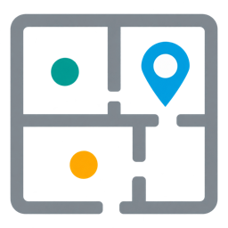
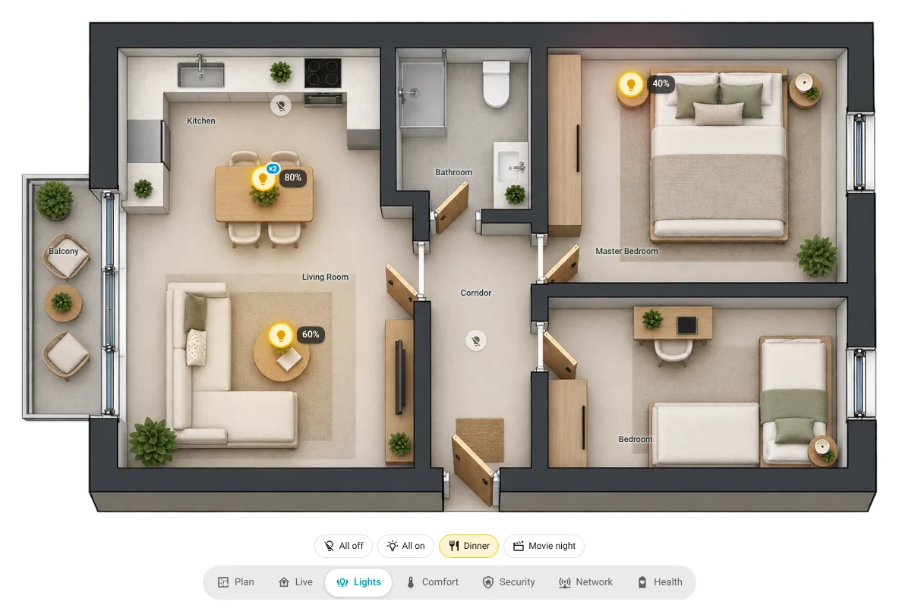
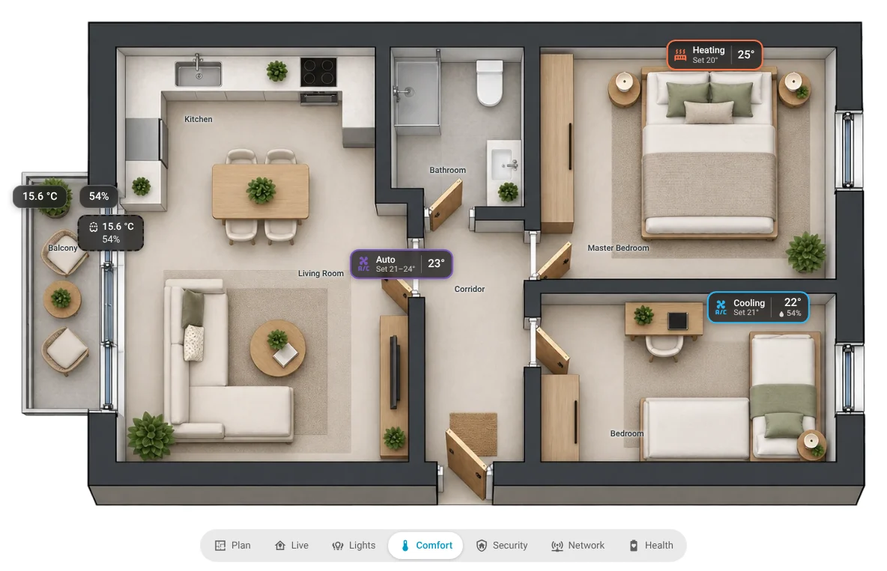
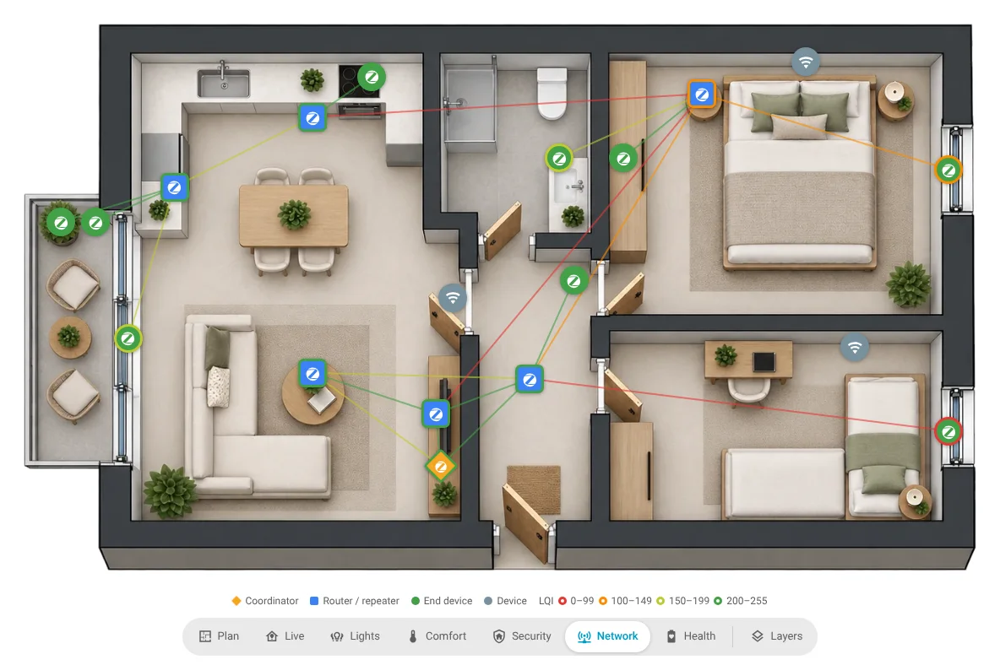

<p align="center"></p>

# Device Floorplan

[](#beta)
[](#install)
[](https://johnkotrolos.github.io/ha-device-floorplan/)
[](LICENSE)

Put your Home Assistant devices on **your own floorplan image**, quickly.
Upload the picture you already have (or start from a sample plan), drop a pin
in each room, press Auto-place and fine-tune by dragging. No wall tracing, no
YAML. Then put the plan on a dashboard with live overlays: lights, comfort,
security, network, health and your own.

<p align="center">
  
  
  
</p>

📖 **Full guide:** https://johnkotrolos.github.io/ha-device-floorplan/

## Beta

Device Floorplan is in **beta**. It runs every day in a real home with ~90
devices, but your setup is different from mine, and that's exactly where
your feedback helps. Please
[open an issue](https://github.com/JohnKotrolos/ha-device-floorplan/issues/new/choose)
for anything that breaks, confuses you or is missing. Screenshots help a lot.

Known limits today:

- Zigbee roles, link quality and links in the Network overlay need **ZHA** and an
  **admin** user (that's what Home Assistant allows).
- Rooms are name pins, not outlines.
- Bonds work for lights, switches and covers.

No floorplan yet? See
[Turn your sketch into a floorplan](docs/images/sketch.md).

## Features

- **Welcome intro** on the first visit (reopen it from ⋮ → Show intro).
- **Create a plan first**, then choose which kinds of devices belong on it
  (the rest is *skipped*: nothing changes in HA).
- **Floorplan image**: drop a file, pick an image that is already in Home
  Assistant (`config/www`, stays linked, a backup copy is kept), or start from
  one of seven bundled **sample plans**.
- Three guided steps:
  1. **Measure** (optional): one horizontal and one vertical measurement give
     the plan a real scale. Drag the ends to adjust, click a label to change
     the length or delete it.
  2. **Mark rooms**: drag your HA areas onto the plan. Rooms that are not on
     this plan can be hidden: their devices leave the list.
  3. **Place devices**: Auto-place, click-to-place (with "then next" queue) or
     drag. Auto-placed devices are *approximate* (dashed) until you drag or
     confirm them.
- **Layers**: the current step is shown in full, the others faded (and not
  clickable). The Layers button on the plan switches them off completely.
- The plan always fits the screen: zoom, scale and layers sit on the plan,
  the legend below always stays visible.
- **Floors**: each plan is an HA floor (or a level, or a free "view"). The ⋮ on
  a floor tab has settings, rename, replace image, export, move and delete.
- **“I'm ready”** appears as soon as the first device is placed: see what was
  created in HA, preview the live view and add it to a dashboard in one click.
- **Dashboard card** `custom:device-floorplan-card` with live states.
- **Export** a plan as CSV, JSON backup (re-importable, also on another HA) or
  PNG picture.
- **Search finds everything**: names, rooms, models, entity names and ids, also
  skipped devices and helpers without a device (which can be placed on their own).
- **What a marker shows** is any entity, also a helper (*Other entity…*); an
  optional second spot for a device's box / radio (wall switch + ceiling lamp).
- **Bond** lamps above one table (or two blinds): one marker, switched together on the card.
- One dot per physical device (printer + AMS, NAS + drives become one), HA's own icons and more-info dialog, integration
  logos in the device list, undo/redo, auto-save, keyboard shortcuts.
- **New devices**: placed next to their room automatically (optional), a
  notification tells you, and the `device_floorplan_new_device` event lets you
  build your own alerts (a blueprint for phone notifications is included).
  Devices removed from HA show as a `?` marker: remove them, or give the spot
  to another device.

## Install

**With HACS (recommended)**

1. HACS → ⋮ (top right) → **Custom repositories**.
2. Repository: `https://github.com/JohnKotrolos/ha-device-floorplan`, type
   **Integration** → Add.
3. Find **Device Floorplan** in HACS → **Download**.
4. Restart Home Assistant.

**Manually:** copy `custom_components/device_floorplan` from the
[latest release](https://github.com/JohnKotrolos/ha-device-floorplan/releases)
into your `config/custom_components/` folder and restart Home Assistant.

**Then:**

1. Settings → Devices & services → Add integration → **Device Floorplan**.
2. Open **Floorplan Editor** in the sidebar (admins only).

Options (Settings → Devices & services → Device Floorplan → Configure):
new-device notification and automatic placement, both on by default.

## What you get in Home Assistant

Each plan is a **device** (“Ground floor plan”) under Settings → Devices with:

- `image.device_floorplan_<plan>`: the plan picture, usable in any card
  (plans created before 0.4.2 keep their existing id).
- `sensor.device_floorplan_<plan>`: state = number of devices on the plan;
  attributes (kept out of the history database): `plan_id`, `image_url`,
  `image_fallback_url`, `image_width`, `image_height`, `kind`, `floor_id`,
  `level`, `image_type`, `metres_per_px_x/y`, `real_width_m`, `real_height_m`,
  `approx_count`, `devices`
  (`{device_id: {name, x, y, px, py, approx, z?, ieee?, mac?, main_entity, entities, roles, conns, group, box?, parts?}}`,
  x/y in % of the image; all entities of a device share its position),
  `entities` (helpers / entities without a device placed on their own),
  `zigbee_devices` (the format of the Zigbee Floorplan Card) and `areas` (room pins).

`sensor.device_floorplan_new_devices`: devices added since setup that are not
placed or skipped yet.

Action:

```yaml
action: device_floorplan.get_positions
data:
  plan: ground_floor
response_variable: plan
```

### Privacy

A floorplan with device positions is a map of your home, so plan images are
**only served to logged-in users** (`/api/device_floorplan/image/…`, the
frontend uses signed URLs). They are stored in `config/device_floorplan/`.
Images you link from `config/www` stay public at `/local/…`, as everything in
that folder. Planner data lives in `.storage/device_floorplan`.

## Dashboard card

The easiest way: press **I'm ready → Add to dashboard** in the Floorplan Editor. The card shows
your plan and its overlay buttons: **Plan · Live · Lights · Comfort · Security · Network · Health**,
plus your own. Tap a light to switch it, a reading for its last 24 hours; hold for the details.
Everything else (which overlays, where the buttons are, what each overlay shows, light scenes,
rooms, tap behaviour, look, per-device icon / name / tap / overlays) is set in the card editor.
Other cards can switch the overlay with the action `device_floorplan.show_overlay`. See [docs/reference/card.md](docs/reference/card.md).

```yaml
type: custom:device-floorplan-card
plan: ground_floor
```

## Keyboard

| Key | Action |
|---|---|
| Esc | Stop placing / measuring, cancel a drag, close menus and panels |
| Ctrl/Cmd+Z, Ctrl/Cmd+Shift+Z (or Ctrl+Y) | Undo, redo |
| Delete / Backspace | Remove the selected device (or the selected measurement) |
| Arrow keys (Shift = bigger steps) | Nudge the selected device |
| Shift while measuring | Don't snap the line straight |

Shortcuts don't fire while you type in a field.

## Related projects

- [Zigbee Floorplan Card](https://github.com/TheLarsinator/zigbee-floorplan-card):
  Zigbee mesh on a floorplan; `zigbee_devices` above can feed it.
- [Spatial Context](https://github.com/Greminn/ha-spatial-context): a full
  building model with traced walls and signal attenuation.
- [ha-floorplan](https://github.com/ExperienceLovelace/ha-floorplan): SVG-based
  interactive floorplans.

## Changelog

- 0.4.7 – beta-ready: typing in the card editor fixed, clearer editor order, Layers in the button bar, links apply every time, fewer redraws.
- 0.4.6 – Lights overlay with scenes, reworked Network overlay, climate chips, rooms on the card, custom overlays, overlay buttons anywhere or hidden, switching overlays from other cards.
- 0.4.5 – new dashboard card with overlays and a card editor where everything is adjustable.

All versions: [docs/help/changelog.md](docs/help/changelog.md).

## Feedback and contributing

Bug reports and ideas are very welcome: [issues](https://github.com/JohnKotrolos/ha-device-floorplan/issues).
Questions and show-and-tell: the Home Assistant community thread (link coming with the first post).

## License

[MIT](LICENSE) © 2026 John Kotrolos. Not affiliated with the Home Assistant project.
