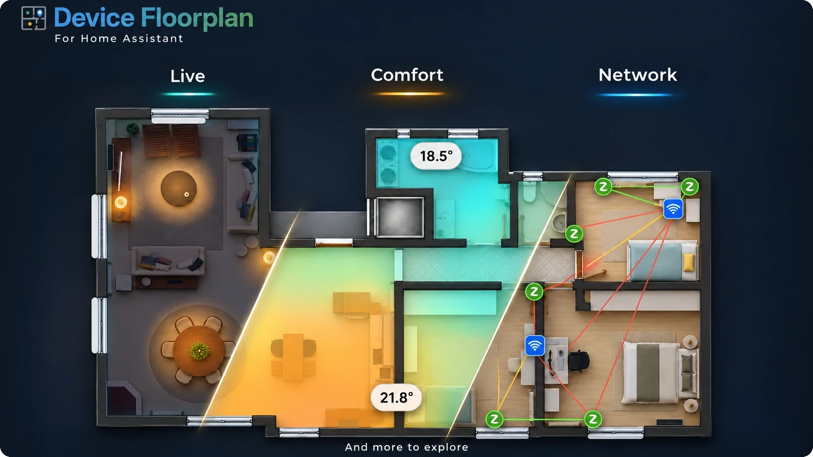
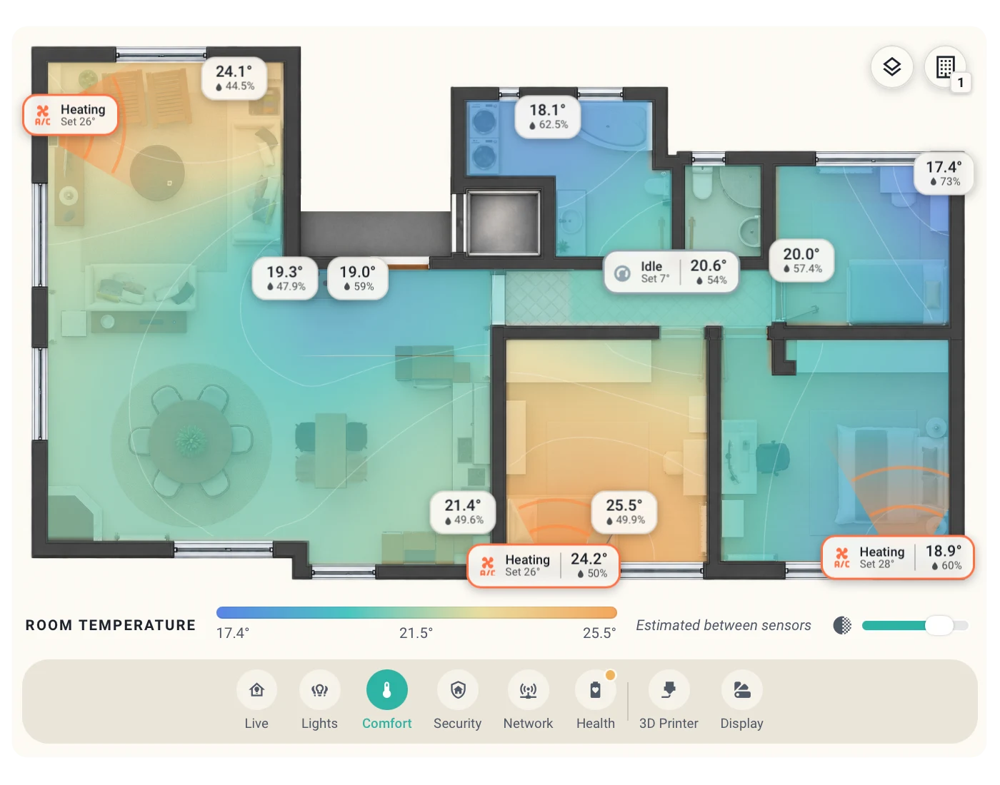
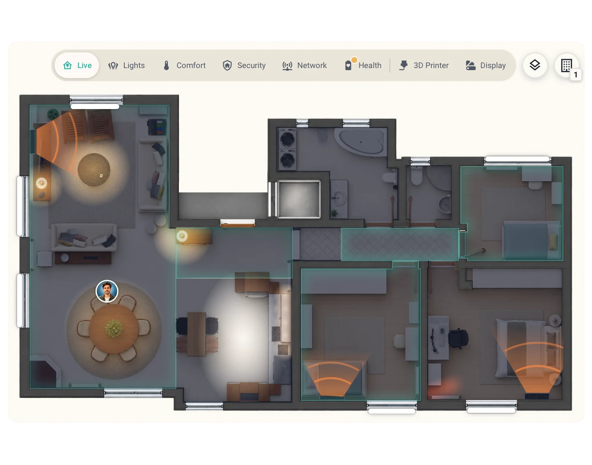
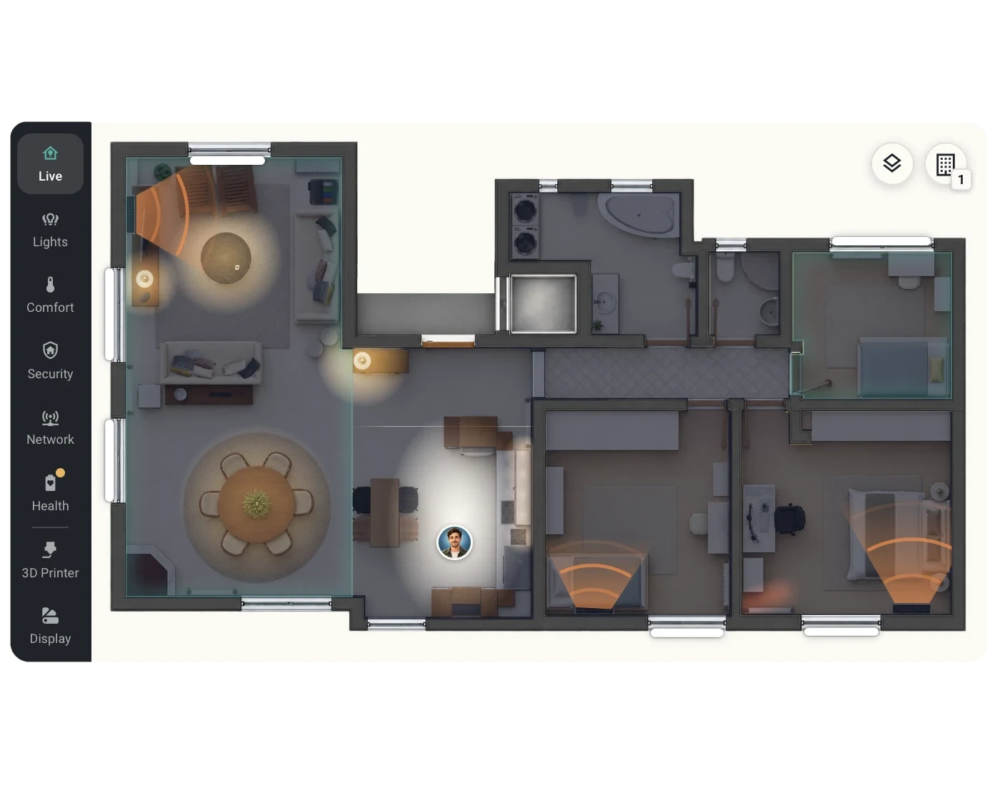
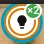
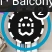

<p align="center"></p>

# Device Floorplan

[](https://github.com/JohnKotrolos/ha-device-floorplan/releases)
[](#install)
[](https://johnkotrolos.github.io/ha-device-floorplan/)
[](https://github.com/JohnKotrolos/ha-device-floorplan/blob/main/LICENSE)

<p align="center">
  
</p>

Put your Home Assistant devices on **your own floorplan** and see your home alive:
lights glowing in their real colour and staying inside their room, the AC blowing,
the TV glowing, the washer telling you it's done, people in their rooms, the
Zigbee mesh drawn over your walls. No custom cards to combine, no templates, no YAML:
upload your picture (or start from a sample plan), drag your rooms onto it, press
**Auto-place** and fine-tune by dragging.

📖 **Full guide:** https://johnkotrolos.github.io/ha-device-floorplan/

🎮 **Live demo:** https://johnkotrolos.github.io/ha-device-floorplan/demo/

## What makes it different

### Your home, alive on the plan

- **Light that behaves like light**: every lamp glows in its real colour and brightness,
  shaped like the fixture (bulb, spot, strip, panel, wall lamp) and **stopped by walls**:
  it fills its room and spills only where rooms are open to each other.
- **Devices that show they are working**: the AC blows an animated air flow in its real
  direction (cooling, heating, drying), TVs glow while they play, washers, dryers and
  dishwashers show their progress and say **"Done · tap to unload"**.
- **Day & night**: at night the plan darkens and only what's on glows; by day daylight
  comes in through windows and shutters, and a room gets darker the more its shutters close.
- **Doors, windows and shutters as bars** on the walls: open, closed, how far a shutter is down.
- **Motion** makes a room pulse, **people** appear in the room they are in.

### Overlays: one plan, many views

- **Live** (what's happening now), **Lights**, **Comfort** (a temperature and humidity
  **heatmap** that flows between open rooms), **Security**, **Network** and **Health**
  (batteries, offline devices), plus **your own overlays** with the device types you choose.
- **Network map**: the Zigbee mesh (ZHA) with roles, links and link quality, Wi-Fi and LAN
  from your router, and the devices on other floors as faint markers.
- **One marker per device per overlay**, and you decide what it shows: the leading value,
  extra readings, a badge, the icon, what a tap does.

### Made for dashboards and wall panels

- **The Overlay Bar**: next to the plan (above, below, left, right) or as a **Side Rail**
  over the full height of the card. Pill, tile or circle buttons, contrast that follows
  light and dark mode, and a status on each button (a dot, a count, a value, an icon that
  turns green while the printer prints).
- **Shortcuts** in the same bar: open a dashboard page, a popup on this browser only,
  run any action, reload the page. Overlay buttons can do something else on hold.
  The bar can be the **menu of your whole wall panel**.
- **Several floors** in one card, with a floor switcher; one frame for the whole house so
  floors line up and switching doesn't jump.
- The plan **fits the card exactly**: top-aligned in fixed-height cards, never stretched,
  with a live preview at your panel's real size in the card editor.
- A **chip card** for your top bar, and an action to switch overlays from other cards.

<table>
  <tr>
    <td align="center" width="33%">
      <a href="docs/public/readme/bar-bottom.webp"></a>
      <br><sub><b>Below the plan</b> · circles (Comfort heatmap)</sub>
    </td>
    <td align="center" width="33%">
      <a href="docs/public/readme/bar-top.webp"></a>
      <br><sub><b>Above the plan</b> · pill (Live)</sub>
    </td>
    <td align="center" width="33%">
      <a href="docs/public/readme/side-rail.webp"></a>
      <br><sub><b>Side Rail</b> · the wall panel's menu</sub>
    </td>
  </tr>
</table>

### Real homes are messy, so it handles them

- <picture><source media="(prefers-color-scheme: dark)" srcset="https://raw.githubusercontent.com/JohnKotrolos/ha-device-floorplan/main/docs/public/legend/bond-badge-dark.webp"></picture> **Bond**: three bulbs in one lamp are one device (one marker, switched together).
- <picture><source media="(prefers-color-scheme: dark)" srcset="https://raw.githubusercontent.com/JohnKotrolos/ha-device-floorplan/main/docs/public/legend/phantom-dark.webp"></picture> **Phantom**: one value from devices anywhere (room temperature from two thermometers,
  "any window open"), shown like a device.
- **Split device**: a wall panel sits where it hangs, each relay where it acts.
- **ZHA groups** become bonds, **child devices** and main entities are understood.
- **Nothing is created or changed in Home Assistant**: no helpers, groups or template
  sensors; your devices stay exactly as they are.

## The Floorplan Editor

A sidebar panel that takes you from a picture to a live plan in three steps:

1. **Measure** (optional): one horizontal and one vertical line give the plan a real
   scale; it warns you when the picture looks stretched.
2. **Mark rooms**: drag your HA areas onto the plan and draw their shapes: drag corners
   or whole walls, let open rooms overlap, leave a gap for a wall. **Glue Rooms** then
   makes neighbouring rooms meet on one line.
3. **Place devices**: **Auto-place**, click-to-place or drag; **snap to wall** for
   switches and sensors.

Plus: a floorplan from a file, from `config/www` or from seven **sample plans**; a frame
around the plan; search across names, rooms, models and entities; undo/redo and
auto-save; export as CSV, JSON backup or PNG. **New devices** are placed next to their
room automatically and announced (event + blueprint included).

No floorplan yet? See
[Turn your sketch into a floorplan in 10 minutes](https://johnkotrolos.github.io/ha-device-floorplan/images/sketch).

## Good to know

- The interactive Zigbee map (roles, links, link quality) needs **ZHA**; Wi-Fi and LAN
  come from your router (FRITZ!Box and others).
- Room shapes are optional: without one, a room is a name pin and its light glow
  isn't stopped by walls.
- Made for PC (Editor) and tablets / wall panels (card); phones work too.
- People need a room sensor per person (Bermuda, ESPresense, a template…).

It runs every day in a real home with ~90 devices. Something not working, confusing or
missing in yours? Please [open an issue](https://github.com/JohnKotrolos/ha-device-floorplan/issues/new/choose);
screenshots help a lot.

## Install

**From the Marketplace (Home Assistant 2026.11 and later, recommended)**

1. Settings → **Marketplace** → add a custom repository by its link:
   `https://github.com/JohnKotrolos/ha-device-floorplan` (the first time,
   Home Assistant asks you to sign in to GitHub, read-only).
2. Find **Device Floorplan** → install, accept the community notice.
3. Restart Home Assistant.

An install made with HACS moves to the Marketplace by itself.

**With HACS (Home Assistant before 2026.11):** HACS → ⋮ → **Custom repositories**
→ the link above, type **Integration** → find **Device Floorplan** → **Download**
→ restart Home Assistant.

**Manually:** copy `custom_components/device_floorplan` from the
[latest release](https://github.com/JohnKotrolos/ha-device-floorplan/releases)
into your `config/custom_components/` folder and restart Home Assistant.

## Quick start

From a picture to a live plan on your dashboard, in about 15 minutes:

1. **Add the integration**:
   [](https://my.home-assistant.io/redirect/config_flow_start/?domain=device_floorplan)
   or Settings → Devices & services → Add integration → **Device Floorplan**.
2. **Create a plan**: open **Floorplan Editor** in the sidebar, create a plan for a floor
   and add its picture (a file, an image in `config/www`, or a sample plan). Frame it if
   it needs space around it.
3. **Measure** (optional): draw one horizontal and one vertical line of a known length.
4. **Mark rooms**: drag your areas onto the plan, press **Shape** and pull the corners or
   walls onto each room. Overlap where rooms are open to each other, leave a gap for a wall,
   then **Glue Rooms**.
5. **Place devices**: press **Auto-place**, then drag what needs to move. Dashed markers
   are guesses until you touch them.
6. **Add it to a dashboard**: **I'm ready → Add to dashboard**. Then open the card editor
   to choose the overlays, the Overlay Bar or Side Rail, shortcuts and floors.

More floors? Repeat steps 2–5 per floor; the card shows them all. Step by step with
pictures: [Your first plan](https://johnkotrolos.github.io/ha-device-floorplan/guide/first-plan).

## Dashboard card

```yaml
type: custom:device-floorplan-card
plans: [ground_floor, first_floor]
```

Everything else (floors, overlays, the Overlay Bar and its shortcuts, what each overlay
shows, light scenes, rooms, people, day & night, look, frame and per-device settings) is
set in the card editor. See [the card reference](https://johnkotrolos.github.io/ha-device-floorplan/reference/card).

## What you get in Home Assistant

Each plan is a **device** (“Ground floor plan”) with:

- `image.device_floorplan_<plan>`: the plan picture, usable in any card.
- `sensor.device_floorplan_<plan>`: the number of devices on the plan; its attributes
  carry every position (in % of the image), rooms, bonds, phantoms and the scale, and
  `zigbee_devices` in the format of the Zigbee Floorplan Card.
- `sensor.device_floorplan_new_devices`: devices added since setup that are not placed yet.
- The action `device_floorplan.get_positions` returns a plan's positions for your own
  automations.

### Privacy

A floorplan with device positions is a map of your home, so plan images are
**only served to logged-in users** (signed URLs). They are stored in
`config/device_floorplan/`. Images you link from `config/www` stay public at
`/local/…`, as everything in that folder. Planner data lives in `.storage/device_floorplan`.

## Related projects

- [Zigbee Floorplan Card](https://github.com/TheLarsinator/zigbee-floorplan-card):
  Zigbee mesh on a floorplan; `zigbee_devices` above can feed it.
- [Spatial Context](https://github.com/Greminn/ha-spatial-context): a full
  building model with traced walls and signal attenuation.
- [ha-floorplan](https://github.com/ExperienceLovelace/ha-floorplan): SVG-based
  interactive floorplans.

## Roadmap and changes

Ideas welcome as issues with the label *idea*. See the
[roadmap](https://johnkotrolos.github.io/ha-device-floorplan/help/roadmap) and the
[changelog](https://johnkotrolos.github.io/ha-device-floorplan/help/changelog).
